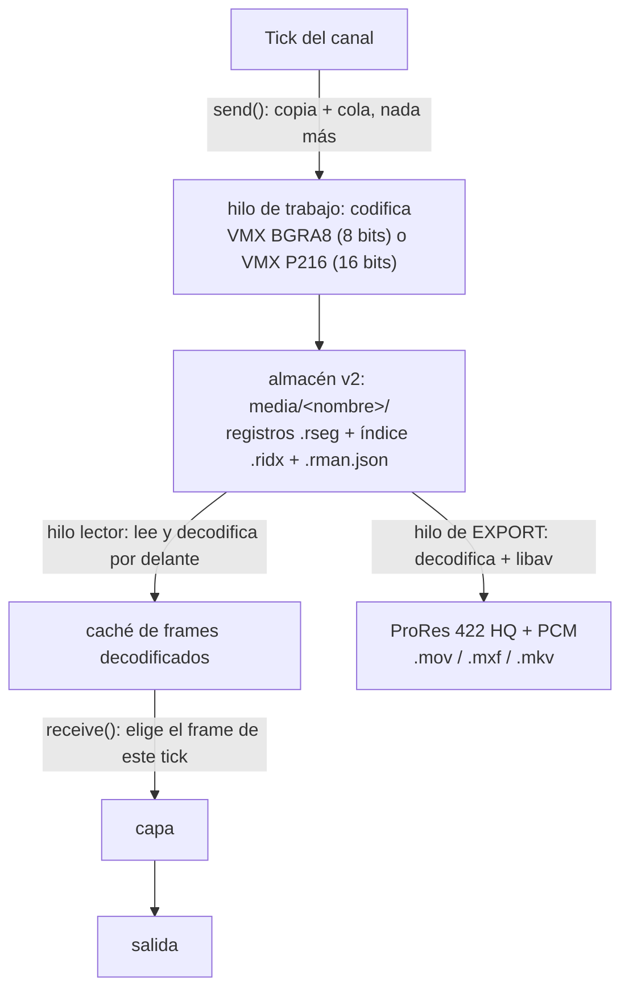

# Módulo de replay

> **Origen:** traducción y adaptación de la guía del módulo de CasparVP
> (`docs/guides/REPLAY_MODULE_USAGE.md` y `docs/features/replay.md` en
> [C-alcaide/CasparVP](https://github.com/C-alcaide/CasparVP), rama `CasparVPV-GS-API`, commit
> `a6cf162ef`). Donde este árbol (CasparCG 2.5.0 + parches de Titania) se comporta distinto del
> fork, se dice en el apartado correspondiente y se resume en el §9.
>
> **Código:** `src/modules/replay`. **Prueba:** `tools/test/replay_test.py` (§10).

## Qué hace

El módulo de replay graba un canal de forma continua y reproduce cualquier punto de esa
grabación, también mientras se sigue escribiendo. Sirve para repeticiones deportivas, diferido
(time-shift) y exportación de jugadas.

* Graba cualquier canal: los de 8 bits como VMX BGRA, **los de 16 bits como VMX 10 bits 4:2:2**.
* Reproduce una grabación que sigue creciendo, desde cualquier punto, o **sigue** su cabeza de
  escritura a una distancia fija (`LIVE`).
* Retención por duración: borra segmentos completos por delante.
* Transporte: búsqueda por posición o por hora de reloj, cualquier velocidad (también hacia
  atrás), bucle, IN/OUT. La búsqueda es **exacta**: el siguiente frame que se muestra tras
  `SEEK N` es el registro N.
* Cada registro lleva su propia cabecera y dos CRC, así que un registro cortado o dañado nunca se
  muestra y una grabación se puede leer sin su índice.
* Exportación dentro del propio servidor a ProRes 422 HQ con el audio grabado, a la cadencia exacta
  de la grabación.

**Plataformas.** Linux y Windows (x86-64; libvmx elige su ruta AVX2 en tiempo de ejecución, así
que la CPU no necesita AVX2). En este árbol está probado en ambos con `tools/test/replay_test.py`
(§10).

---

## 1. Arquitectura



Ni la grabación ni la reproducción hacen E/S ni trabajo de códec en el hilo del canal. El consumer
copia el frame a una cola de cuatro posiciones y un hilo de trabajo lo codifica y lo escribe; si la
cola está llena se descarta un frame y se cuenta, pero el canal nunca se bloquea. El hilo lector del
producer decodifica hasta ocho ticks por delante en el sentido de reproducción, y el hilo del canal
solo elige entre lo que ya está listo. Un tick cuyo frame no está listo se decodifica de forma
síncrona y se cuenta en `replay/late_decodes`.

### Códecs

| canal | códec | qué se guarda |
| :--- | :--- | :--- |
| 8 bits | `vmx-bgra8` | la ruta de 8 bits propia de libvmx |
| 16 bits (`<color-depth>16</color-depth>`) | `vmx-p216` | Y'CbCr 4:2:2 de 10 bits en rango de estudio, convertido en el hilo de trabajo con **la matriz del canal** (BT.601, BT.709, BT.2020; cualquier otra como BT.709), croma co-situado |

El perfil de calidad (`LQ` … `OMT_HQ`, §2) se aplica a ambos.

> **En este árbol:** la base 2.5.0 no tiene etiqueta de posición del croma, y su shader reconstruye
> el croma como centrado. Por eso, al reproducir una grabación de 10 bits, el croma queda desplazado
> medio píxel de luma en horizontal. Sobre colores planos no se nota (medido: un gris sale idéntico);
> sobre bordes de color muy finos, sí podría. Afecta solo a canales `<color-depth>16`.

### Ficheros en disco

```
media/
  mi_grabacion/
    mi_grabacion.rman.json        manifiesto: versión, códec, tamaño, cadencia, campos, profundidad, color, audio
    mi_grabacion.000000.rseg      segmento 0: cabecera de 256 bytes (magic CVPRPL2) y después los registros
    mi_grabacion.000000.ridx      su índice: cabecera de 64 bytes (magic CVPRIX2), 32 bytes por registro
    mi_grabacion.000001.rseg
    mi_grabacion.000001.ridx
    ...
```

Un **registro** es una cabecera de 64 bytes seguida del audio (PCM entero de 32 bits) y de la carga
de vídeo. La cabecera lleva el magic `RRC2`, el número de frame, el hueco del timecode, flags, la
hora de reloj en microsegundos, los dos tamaños de carga, un CRC-32C de la carga y un CRC-32C de la
propia cabecera.

El `.ridx` es una **caché**. Una entrada de índice solo se escribe después de volcar a disco su
registro, y un lector que encuentra registros completos y válidos más allá de la última entrada los
usa. Así, una grabación que ha perdido su índice, o cuyo índice va por detrás, se sigue reproduciendo
hasta su último registro completo. Un registro cuyos bytes no están todos en disco (una cola cortada)
no forma parte de la grabación. Un registro cuyo CRC de carga falla nunca se decodifica; se cuenta en
`replay/bad_records`.

**Los números de frame indexan la grabación.** Los registros se numeran por el tick del canal que
graba, así que un frame descartado es un hueco visible y no un desplazamiento de toda la línea de
tiempo.

### Canales entrelazados

En un formato entrelazado el canal entrega un frame por **tick de campo**, así que un canal 1080i50
escribe 50 registros por segundo, cada uno con la imagen de un campo. A velocidad 1 se reproducen a
razón de uno por tick.

### Protección contra sobrescritura

Si `media/<nombre>/` ya existe, la nueva grabación se crea como `<nombre>_AAAAMMDD_HHMMSS_mmm` y se
registra un aviso en el log. La grabación existente no se toca. La ruta resultante se publica como
`file/path` (§6). Esto ocurre cuando el consumer **arranca**, no cuando se construye, así que un
`REMOVE` nunca renombra ni crea nada.

---

## 2. Grabación (consumer)

```
ADD <canal> REPLAY <nombre>[?<opciones>] [<calidad>]
REMOVE <canal> REPLAY <nombre>
```

El nombre es relativo a la carpeta de media.

**Se pueden tener varias grabaciones en un mismo canal.** El índice de cada consumer se deriva de su
nombre (`200000 + FNV-1a(nombre en minúsculas, UTF-8, sin las ?opciones) % 9999`). Dos nombres
graban a la vez, y `REMOVE` encuentra el que nombra, con o sin las opciones. Añadir **el mismo**
nombre dos veces en un canal sustituye al primero, como con cualquier consumer de igual índice.

### Opciones

| Parámetro | Formato | Por defecto | Descripción |
| :--- | :--- | :--- | :--- |
| `segment` (o `segment_duration`) | segundos | `60` | Duración de cada fichero de segmento. |
| `max_duration` | `HH:MM` o segundos | `86400` (24 h) | Retención. Los segmentos más antiguos se borran. |
| `duration` | `HH:MM` o minutos | -- | La forma antigua de `max_duration`, en MINUTOS; si se dan las dos, gana `max_duration`. |

Cada opción se interpreta de forma estricta y cualquier otra cosa se rechaza: una clave
desconocida, un valor que no sea un número entero o `HH:MM` con minutos por debajo de 60, y una
calidad desconocida.

La retención borra segmentos completos por delante y conserva en disco al menos `max_duration`. Los
lectores abren los segmentos permitiendo su borrado, así que un reproductor aparcado en el material
más antiguo no bloquea la retención: lo que se mueve es el inicio de su línea de tiempo. Si aun así
un borrado falla, se registra un aviso y la retención lo vuelve a intentar con el siguiente segmento.

### Perfiles de calidad

Tercer argumento de `ADD`; `SQ` si se omite.

| Perfil | Objetivo a 1080p60 | Precisión DC | Notas |
| :--- | :--- | :--- | :--- |
| `LQ` | 86 Mbps | Baja | proxy / almacenamiento limitado |
| `OMT_LQ` | 86 Mbps | Baja | adaptativo |
| `SQ` | 130 Mbps | Baja | **por defecto** |
| `OMT_SQ` | 200 Mbps | Alta | más calidad que SQ |
| `HQ` | 260 Mbps | Alta | máster |
| `OMT_HQ` | 260 Mbps | Alta | adaptativo |

Son las cifras de libvmx para la ruta de 8 bits. Escalan linealmente con la cadencia, y una
grabación P216 de 10 bits ocupa más.

### Cuando la grabación falla

Un fallo de escritura se registra **una sola vez** como error, con la ruta y el error del sistema
operativo. Las causas incluyen un disco lleno, un directorio sin permiso de escritura o un segmento
que no se puede crear. `replay/state` del consumer pasa a `failed`, `replay/error` lleva el motivo,
y no se codifica nada más. El consumer sigue en el canal, para que el estado se pueda leer; para
volver a grabar, `REMOVE` y otra vez `ADD`.

### Ejemplos

```
ADD 1 REPLAY "partido_01"                                  # SQ, segmentos de 60 s, retención 24 h
ADD 1 REPLAY "partido_01" OMT_HQ
ADD 1 REPLAY "cam_a?max_duration=01:00&segment=30"         # la última hora, segmentos de 30 s
ADD 1 REPLAY "cam_b?max_duration=01:00&segment=30"         # una segunda grabación en el mismo canal
REMOVE 1 REPLAY "cam_a"
```

---

## 3. Reproducción (producer)

```
PLAY <canal>-<capa> <nombre> [LOOP] [IN <p>] [OUT <p>] [LENGTH <n>] [SEEK <p>|LIVE] [LIVE [<d>]] [SPEED <v>]
```

`<p>` es una posición (un índice de registro desde 0) o una hora (§4). Una palabra clave reconocida
cuyo valor no se puede interpretar **rechaza el PLAY** (`SEEK banana`, `SPEED x`, `LENGTH -3`). Las
palabras desconocidas se ignoran, porque la lista de parámetros de PLAY también lleva la transición
(`MIX 25`).

Sin `SEEK`, la reproducción empieza en el registro 0, o en `IN`.

```
PLAY 2-10 "partido_01"                       # desde el primer registro
PLAY 2-10 "partido_01" LIVE                  # sigue la cabeza de escritura, dos registros por detrás
PLAY 2-10 "partido_01" LIVE 5                # ...cinco por detrás
PLAY 2-10 "partido_01" SEEK 1200 SPEED 0     # parado en el registro 1200
PLAY 2-10 "partido_01" LOOP IN 100 OUT 500
PLAY 2-10 "partido_01" IN 2026-10-19-14-30-00-00 LENGTH 250
```

### Modo seguimiento (`LIVE`)

`LIVE [d]` muestra en cada tick el registro `longitud-1-d` de la grabación en curso, así que la
imagen va siempre `d` registros por detrás de la cabeza de escritura (2 por defecto). Es un modo, no
una búsqueda puntual. Se sale de él con un `SEEK` o con una velocidad distinta de 1.
`replay/live` y `replay/live_distance` lo publican.

### Audio

Las muestras grabadas suenan exactamente a velocidad 1, una vez por registro. A cualquier otra
velocidad, en pausa y en un extremo, la capa queda en silencio.

### Grabaciones anteriores a v2

El formato antiguo `.mav`/`.idx` se sigue reproduciendo con el lector antiguo, solo lectura;
`replay/legacy` vale `true`. Tiene las correcciones de transporte, pero ninguna de las comprobaciones
de integridad de v2.

---

## 4. Posiciones y horas

Todo argumento de punto (`SEEK`, `IN`, `OUT`, los puntos de `EXPORT`) acepta:

* una **posición**: un número entero desde 0, el índice del registro en la grabación tal como está
  ahora;
* una **hora**: `aaaa-mm-dd-hh-mm-ss-ff` (`ff` es el frame dentro del segundo) o ISO 8601
  (`2026-10-19T14:30:00`), comparada con la hora de reloj guardada en cada registro.

Cualquier otra cosa se rechaza.

Cuando la retención borra el principio de una grabación, las posiciones se desplazan: el registro 0
es siempre el más antiguo que sigue en disco. Una hora apunta al mismo instante mientras ese instante
siga en disco.

---

## 5. Transporte (`CALL`)

| verbo | efecto |
| :--- | :--- |
| `SEEK <p>` | el siguiente frame mostrado es `<p>`, a cualquier velocidad; sale del modo seguimiento |
| `SEEK LIVE [d]`, `LIVE [d]` | entra en modo seguimiento `d` registros por detrás de la cabeza (2 por defecto) |
| `IN <p>`, `OUT <p>` | rango de reproducción; `OUT` es exclusivo, `OUT 0` sigue el final del material |
| `LOOP 1\|0` | bucle entre IN y OUT. `LOOP` sin argumento **responde** el estado y no cambia nada |
| `SPEED <v>` | cualquier número finito; `0` pausa, negativo reproduce hacia atrás. Avanzar rápido hasta el final de una grabación en curso vuelve a `1` |
| `EXPORT …` | §5.1 |

Un valor que no se puede interpretar se rechaza con **`403 CALL FAILED`**, nunca se responde OK; el
motivo queda en el log (`Check syntax: [replay] ...`).

> **En este árbol:** el fork publica además este transporte como parámetros de su API de control
> HTTP (`position`, `speed`, `loop`, `in`, `out`, `length`). La base 2.5.0 no tiene esa API, así que
> aquí el transporte se maneja **solo por AMCP**.

### 5.1 EXPORT

```
CALL <canal>-<capa> EXPORT <fichero de salida> [<nombre de entrada>] <in> <out> [[<nombre de entrada>] <in> <out> ...]
```

```
CALL 2-10 EXPORT "gol.mov" 1200 1500                        # de la grabación de esta capa
CALL 2-10 EXPORT "gol.mov" "cam_b" 1200 1500                # de otra grabación
CALL 2-10 EXPORT "resumen.mov" "cam_a" 0 100 "cam_b" 50 150 # concatenadas
```

La exportación se hace dentro del servidor, sin `ffmpeg` en el PATH y en su propio hilo. La
codificación usa como mucho la mitad de los núcleos de la máquina, para no competir con el canal.
Una ruta de salida relativa se resuelve contra la carpeta de media.

* **Vídeo:** ProRes 422 HQ, 10 bits 4:2:2, con las etiquetas de color de la grabación.
* **Cadencia:** la exacta de la grabación, como fracción (`60000/1001`, no 59). En una grabación
  entrelazada es la cadencia de campo, una imagen por registro.
* **Audio:** todos los canales grabados, como PCM de 24 bits.
* **Contenedor:** según la extensión de salida (`.mov`, `.mxf`, `.mkv`).

`CALL` responde enseguida con `201 CALL OK` y la línea `EXPORT STARTED`. El progreso y el resultado
se publican en el producer como `export/state` (`running`, `done` o `failed`), `export/path`,
`export/frames` y `export/error`. Un segundo `EXPORT` mientras otro está en marcha se **rechaza** con
`403 CALL FAILED` (en el log: `EXPORT BUSY`).

> **En este árbol:** el fork responde a ese caso `201 CALL OK` con el texto `400 EXPORT BUSY` como
> dato, que un cliente lee como éxito, y su `EXPORT STARTED` lleva un salto de línea propio que
> añade una línea vacía de más en el cable. Aquí las dos cosas están corregidas.

---

## 6. Estado publicado

Se lee con `INFO <canal>` (XML) o por OSC.

En el consumer (`channel/<n>/output/port/<índice>/`):

| clave | valor |
| :--- | :--- |
| `file/path` | el directorio de la grabación, después de un posible renombrado por sobrescritura |
| `replay/state` | `recording` o `failed` |
| `replay/error` | vacío, o el motivo del fallo |
| `replay/codec` | `vmx-bgra8` o `vmx-p216` |
| `replay/frames_written`, `replay/dropped_frames`, `replay/segments` | contadores (`frames_written` y `dropped_frames` antiguos se mantienen con los mismos valores) |

En el producer (`channel/<n>/stage/layer/<l>/foreground/`):

| clave | valor |
| :--- | :--- |
| `file/frame`, `file/length`, `file/fps`, `file/time` | la posición mostrada, el número de registros, la cadencia de registros, la posición en segundos |
| `replay/frame_number` | el número de frame guardado en el registro mostrado |
| `replay/live`, `replay/live_distance`, `replay/at_end` | modo seguimiento y estado de final |
| `replay/decoded_ahead`, `replay/late_decodes` | frames listos por delante; ticks que tuvieron que decodificar de forma síncrona |
| `replay/bad_records` | registros rechazados por su CRC |
| `replay/codec`, `replay/legacy` | el códec de la grabación; si es anterior a v2 |
| `vmx/timestamp`, `vmx/timestamp_formatted` | la hora de reloj del registro mostrado |
| `export/state`, `export/path`, `export/frames`, `export/error` | la última exportación |

> **Nota sobre `INFO`:** con el parche de pico de audio por capa de este árbol, el XML de `INFO`
> contiene etiquetas como `<0>`, `<1>` bajo `audio/peak/` (INFO solo renombra los segmentos
> numéricos intermedios, no el último). Eso no es XML válido: un cliente que lo parsee con un
> parser estricto tiene que corregirlas antes (`tools/test/replay_test.py` lo hace). No es un
> problema del módulo de replay, pero se ve en cuanto una capa de replay tiene audio.

---

## 7. Diagnóstico

* **Gráfico del consumer:** `frame-time` (codificación y escritura por frame) y `queue` (cuánto está
  llena la cola de grabación). El título es el nombre y la ruta.
* **Gráfico del producer:** `ahead` (frames decodificados listos) y una marca `late-decode` en cada
  tick que tuvo que decodificar de forma síncrona.

---

## 8. Buenas prácticas

* **Almacenamiento:** SSD local rápido. A 1080p60 `HQ`, cuenta con unos 33 MB/s por grabación, más
  en 10 bits y en 4K. Deja sitio para `max_duration` más un segmento.
* **Segmentos:** 30–60 s. La retención trabaja con segmentos completos, así que el búfer guarda hasta
  un segmento más que `max_duration`.
* **Replay en directo:**
  ```
  ADD 1 REPLAY "directo?max_duration=01:00&segment=30"
  PLAY 2-10 "directo" LIVE                   # una copia diferida del aire, dos registros por detrás
  CALL 2-10 SEEK 2026-10-19-14-30-00-00      # el momento
  CALL 2-10 SPEED 0.5
  CALL 2-10 LIVE                             # vuelve a seguir el aire
  CALL 2-10 EXPORT "gol.mov" 2026-10-19-14-30-00-00 2026-10-19-14-30-15-00
  ```
* **Vigila** `replay/state` en cada grabación, y `replay/late_decodes` en cada reproductor. Lo
  primero es la única señal de que una grabación se ha parado. Un contador que no deja de subir en lo
  segundo significa que el decodificador no da abasto a esa velocidad y resolución.
* **Un canal sin consumers no mezcla** en 2.5.0 (`video_channel.cpp`, `has_consumers`). Un canal de
  reproducción cuya salida se monta y desmonta (por ejemplo, capturas puntuales con `ADD n IMAGE`)
  entrega en la primera captura un frame antiguo, que quedó en la tubería del mezclador la última vez
  que hubo un consumer. No es del replay; basta con tener un consumer permanente en ese canal.

---

## 9. Diferencias con el módulo del fork

| | CasparVP | este árbol |
| :--- | :--- | :--- |
| Transporte | AMCP y parámetros de la API de control HTTP | solo AMCP |
| 10 bits (`vmx-p216`) | el mezclador sabe que el croma es co-situado y de rango limitado | 2.5.0 no tiene esas etiquetas: croma centrado (medio píxel de luma), y las muestras se reescalan por 65535/65280 para que el shader de 2.5.0, que cuenta una textura de 16 bits en códigos de 8, no deje 2 LSB de dominante |
| `EXPORT` ocupado | `201 CALL OK` con `400 EXPORT BUSY` como dato | `403 CALL FAILED` |
| Respuesta de `EXPORT` | `EXPORT STARTED` + una línea vacía de más | `EXPORT STARTED` |
| Valor no válido en `CALL` | `501` (error interno) | `403` (error de sintaxis), con el motivo en el log |

Además, para que el módulo funcione en este árbol se corrigieron dos cosas fuera de él:

* **`src/protocol/amcp/AMCPCommandQueue.cpp`**: un comando diferido (como `CALL`) cuyo resultado
  lanzaba una excepción no respondía **nada**, y el cliente se quedaba esperando. `CALL 2-10 BANANA`
  agotaba el timeout del cliente; ahora responde `403 CALL FAILED`.
* **`src/modules/ffmpeg/producer/ffmpeg_producer.cpp`**: en Linux el producer FFmpeg intentaba leer
  `media/<nombre>/` como fichero en cada `PLAY` de una grabación, y dejaba en el log un error con
  backtrace (`Is a directory`). La reproducción funcionaba igual; ahora los directorios se descartan
  antes de abrirlos.

---

## 10. Prueba

`tools/test/replay_test.py` arranca un servidor con su propia configuración (tres canales 720p50, el
tercero de 16 bits; puerto AMCP **5290**, para no tocar un servidor de producción en 5250), graba,
reproduce y comprueba la **imagen** con el consumer `IMAGE`, no solo lo que el servidor publica. Solo
usa la biblioteca estándar de Python 3; si hay `ffprobe` en el PATH inspecciona también el fichero
exportado.

```bash
# Linux
python3 tools/test/replay_test.py --server build/shell/casparcg
# Windows
python tools\test\replay_test.py --server build\shell\casparcg.exe
# Docker (Ubuntu 24.04), ver la cabecera de tools/test/Dockerfile
docker build -f tools/test/Dockerfile -t casparcg-replay-test .
docker run --rm --gpus all -e NVIDIA_DRIVER_CAPABILITIES=all casparcg-replay-test
```

Sale con 0 solo si pasan todas las comprobaciones; una comprobación que no llega a ejecutarse cuenta
como fallo.

| comprobación | cómo puede fallar |
| :--- | :--- |
| la grabación crea su manifiesto y segmentos `.rseg`, con `vmx-bgra8` en 8 bits | no hay ficheros, o el códec es otro |
| una grabación en curso se reproduce, y `SEEK 0` y `SEEK final` muestran **los dos colores** que hubo en el aire (con R y B intercambiados entre ellos) | una búsqueda que no busca nada, o un fallo de orden de canales, da el mismo color en los dos extremos |
| `CALL BANANA`, `CALL SPEED banana`, `CALL SEEK banana`, `PLAY ... SPEED x` se rechazan con 4xx | OK, un 5xx, o ninguna respuesta |
| `LIVE 3` se mantiene a 3 registros de la cabeza mientras la grabación crece | otra distancia en cualquiera de seis muestras |
| `EXPORT` de 250 registros: `done`, ProRes con 250 frames a `50/1`, pista PCM; un segundo `EXPORT` mientras corre se rechaza | `ffprobe` sobre el fichero |
| la retención borra (`segment=2`, `max_duration=6`), y la línea de tiempo del reproductor no supera lo que hay en disco | más de 5 segmentos, o una longitud mayor que (6 + 4) s × 50 |
| un canal de 16 bits graba `vmx-p216`, y un gris se reproduce idéntico y neutro (diferencia entre canales ≤ 1 LSB) | sin el reescalado de §9, 2 LSB de dominante: **verificado con una mutación**, falla |
| `REMOVE` de una segunda grabación la quita y deja la primera grabando | |

**Resultados (2026-11-05): 28/28** en WSL2 Ubuntu 24.04 (GCC 13.3, FFmpeg 6.1, mezclador OpenGL
sobre el driver D3D12 de Mesa), **28/28** en Windows 10 (MSVC 14.50, Release, FFmpeg 7.0.2) y
**28/28** en Docker con la imagen de `tools/test/Dockerfile` (Ubuntu 24.04, ejecutada en WSL2 con
`--device /dev/dxg` y `GALLIUM_DRIVER=d3d12`). Ninguna de las tres con GPU NVIDIA nativa en Linux:
la variante `--gpus all` del Dockerfile no se ha ejecutado.

**Lo que no cubre:** varios reproductores a la vez y el coste a 1080p50/2160p; la recuperación de una
grabación tras matar el servidor (el lado del lector se cubre en el fork, el del escritor en
ninguno); el borrado de un segmento que un lector tiene abierto; el modo entrelazado; el formato
antiguo `.mav`; y la salida por una tarjeta real (todas las capturas son del consumer `IMAGE`). En
WSL hay que usar `GALLIUM_DRIVER=d3d12`: con llvmpipe, el primer draw del mezclador se queda
compilando el shader y el canal no avanza.
