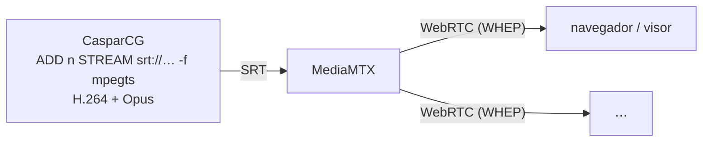

# WebRTC en este árbol: qué funciona hoy y qué costaría lo demás

> Exploración medida el 2026-11-05 en WSL2 Ubuntu 24.04 (la plataforma de producción), con
> MediaMTX 1.21.3 en Docker como servidor WebRTC y un receptor WHEP de prueba
> (`tools/test/whep_probe.py`, aiortc) que comprueba lo que llega de verdad: frames, tamaño,
> color y nivel de audio. Nada de esto es todavía un despliegue.

## Resumen

| ruta | qué hace falta | medido |
| :--- | :--- | :--- |
| **A. Pasarela** — CasparCG `STREAM` por SRT a MediaMTX, que lo sirve por WebRTC (WHEP) | **nada en CasparCG**: el binario y el FFmpeg 6.1 de hoy | 1280x720 a 50 fps completos y audio Opus a -18,0 dBFS (el seno de origen) en el receptor WebRTC |
| **B. WHIP nativo** — CasparCG publica WebRTC directamente (`-f whip`) | CasparCG compilado contra **FFmpeg 8** (Ubuntu 24.04 trae 6.1; hay que compilarlo y llevar sus `.so`) | 1280x720 y audio Opus a -18,0 dBFS; primer frame a 0,39 s de suscribirse. Ver la advertencia de §3 |
| **C. GStreamer** (el módulo de CasparVP) | portar el módulo (~5800 líneas que dependen del núcleo del fork) y compilar gst-plugins-rs: el GStreamer de Ubuntu 24.04 no trae los elementos WHIP/WHEP | no medido |
| **Entrada WebRTC** (WHEP/WHIP hacia CasparCG) | FFmpeg no tiene demuxer WHEP. Opciones: MediaMTX recibe WHIP y CasparCG lee su SRT/RTSP; o el productor HTML (CEF) reproduce un reproductor WHEP | no medido |

**Recomendación: la ruta A.** Funciona hoy, sin tocar CasparCG, y separa dos problemas: CasparCG
sigue haciendo lo que ya hace bien (SRT), y el servidor WebRTC (MediaMTX, un binario o un
contenedor) se ocupa de ICE, DTLS, NAT y de servir a muchos espectadores, cosa que CasparCG no
hace en ninguna de las rutas (WHIP publica UNA vez hacia un servidor; los espectadores siempre
se conectan a ese servidor).

---

## 1. Ruta A: SRT a MediaMTX



```
ADD 1 STREAM "srt://<mediamtx>:8890?streamid=publish:mosaico&pkt_size=1316" -f mpegts -c:v libx264 -preset veryfast -tune zerolatency -g 50 -bf 0 -c:a libopus -b:a 128k -filter:a pan=stereo|c0=c0|c1=c1
```

* **Opus, no AAC.** WebRTC no transporta AAC, y MediaMTX no transcodifica: con AAC el visor
  recibe vídeo sin sonido. Opus dentro de MPEG-TS lo admite el FFmpeg 6.1 de Ubuntu.
* **`-bf 0`**: los navegadores reproducen H.264 sin B-frames de forma fiable.
* **`pan=stereo`**: el canal lleva 16 pistas de audio y Opus en WebRTC es estéreo.
* El visor abre `http://<mediamtx>:8889/mosaico` (MediaMTX sirve un reproductor) o usa WHEP en
  `http://<mediamtx>:8889/mosaico/whep`.

Medido: MediaMTX publica la ruta con pistas `H264` y `Opus`; el receptor WHEP recibe 250 frames
en ~5 s a 1280x720 y audio a -18,0 dBFS (`-18,0` es el nivel del seno que se emite).

Lo que no cubre: latencia de extremo a extremo (cristal a cristal), varios visores, NAT/TURN fuera
de una sola máquina, y un navegador real (el receptor es aiortc).

## 2. Por qué no "solo FFmpeg" en Ubuntu 24.04

El muxer WHIP aparece en **FFmpeg 8**. Ubuntu 24.04 trae 6.1 y no tiene paquete de 8.x, así que
la ruta B obliga a compilar FFmpeg y llevar sus bibliotecas junto al binario
(`PKG_CONFIG_PATH=<prefijo>/lib/pkgconfig` al configurar; `$ORIGIN` como rpath, que la Fase 4C ya
pone). Además, este árbol **no funcionaba** con FFmpeg 8 aunque compilara: FFmpeg 8 quitó las
opciones de lista del buffersink (`pix_fmts`, `sample_fmts`, `sample_rates`) y cada PLAY y cada
salida fallaba con EINVAL al construir el grafo. Está corregido en esta rama (upstream 480e9b00e),
y por debajo de FFmpeg 8 el código es exactamente el de antes.

## 3. Ruta B: WHIP nativo

```
ADD 1 STREAM "http://<mediamtx>:8889/mosaico/whip" -f whip -c:v libx264 -preset veryfast -tune zerolatency -g 50 -bf 0 -c:a libopus -b:a 128k -filter:a pan=stereo|c0=c0|c1=c1
```

Medido con CasparCG compilado contra FFmpeg 8.1.2: MediaMTX recibe la publicación WHIP con pistas
`Opus` y `H264`, y el receptor WHEP recibe 283 frames en ~6 s a 1280x720 y audio a -18,0 dBFS.

**FFmpeg 8 no es apto todavía para las ENTRADAS del mosaico.** Con FFmpeg 8.1.2, tras 3 s de
MPEG-TS corrupto (escenario `corrupt` de `tools/test/live_input_test.py`) el vídeo de la entrada se
quedó congelado para siempre en 2 de 7, 2 de 15 y 1 de 15 ejecuciones; con el FFmpeg 6.1 del
sistema y el mismo código, en 0 de 19. El audio sigue sonando.

Lo medido del estado congelado: el grafo de filtros de vídeo deja de pedir frames
(`av_buffersrc_get_nb_failed_requests` = 0) pero sigue entregando, así que repite la última imagen;
el decodificador tiene la cola de salida llena y la de entrada crece sin límite (152 → 909
paquetes). La causa raíz NO está establecida. Se descartaron, midiendo: un paquete vacío que cierre
el decodificador, un fin de stream del decodificador o del filtro, una reconstrucción del grafo sin
vídeo, y un decodificador que acepte paquetes sin devolver frames. Sembrar el grafo reconstruido sin
`start_time` tras una discontinuidad no lo arregló (2 de 15) y empeoró FFmpeg 6.1 (la prueba de
corrupción pasó a fallar), así que se descartó.

Para WHIP nativo con entradas fiables haría falta, por tanto, o resolver esto o no usar FFmpeg 8 en
el mismo proceso que las entradas: es otro motivo para la ruta A.

## 4. GStreamer

CasparVP tiene un módulo GStreamer (productor y consumer). Su guía lista `whipclientsink`,
`whepclientsrc` y `webrtcsink`, pero como inventario de lo instalado: nunca se integraron ni se
midieron. Para este árbol habría que:

* **Portar el módulo**: ~5800 líneas que dependen de piezas del núcleo del fork que este árbol no
  tiene (`frame_metadata`, `alpha_mode`, `transport_params`, los puentes D3D11/Vulkan).
* **Conseguir los elementos**: el GStreamer 1.24.2 de Ubuntu 24.04 trae `webrtcbin`, `srtsrc` y
  `srtsink`, pero **ninguno** de `whipsink`, `whepsrc`, `whipclientsink`, `whepclientsrc` ni
  `webrtcsink` (comprobado con `gst-inspect-1.0`). Están en gst-plugins-rs, que Ubuntu no empaqueta:
  hay que compilarlo con Rust, o escribir la señalización WHIP sobre `webrtcbin`.

Lo que GStreamer sí aportaría y FFmpeg no: **entrada** WebRTC (`whepclientsrc`). Para mejorar las
entradas SRT en general no hay nada medido que lo justifique: los defectos de entrada encontrados
en este trabajo estaban en el código de CasparCG alrededor de FFmpeg, no en FFmpeg, y están
corregidos en esta rama.

## 5. Entrada WebRTC

Sin medir. Dos caminos sin código nuevo en CasparCG: MediaMTX recibe WHIP de la fuente y CasparCG
lo lee por SRT o RTSP como cualquier otra entrada; o el productor HTML (CEF soporta WebRTC) carga
el reproductor WHEP de MediaMTX. El primero conserva el audio por la ruta normal de FFmpeg; el
segundo pasa el audio por CEF.
